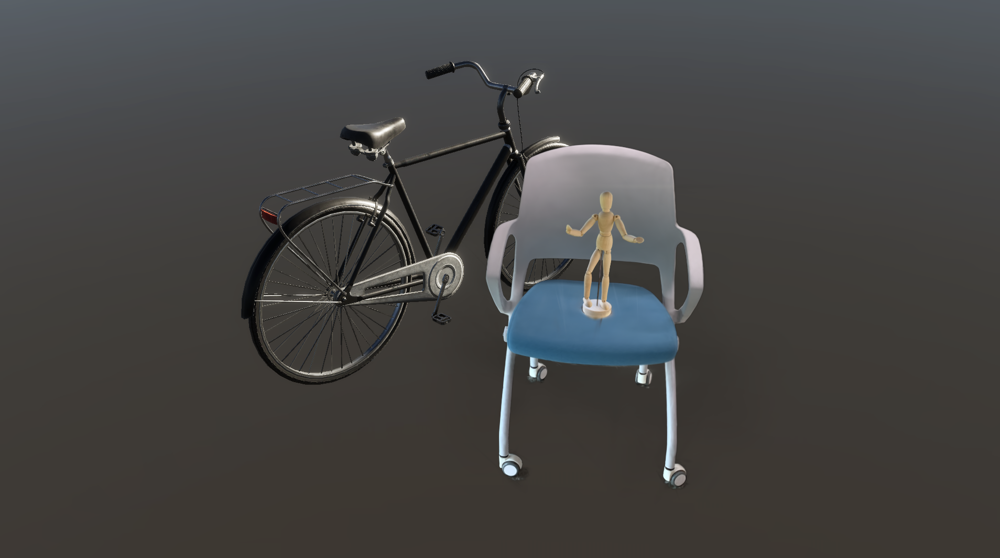

# Paper03 Thesis v13 수정 표

- 기준 문서: `Paper03-thesis-v12.hwpx`에서 추출·정리한 `Paper03-thesis-v12.md`
- 수정 문서: `Paper03-thesis-v13.md`
- 확인한 참고 자료: `paper02-04.pdf` = “3D Gaussian Splatting 기법을 활용한 디지털 조형물 제작 연구”, `poster02-01.pdf` = “3D Gaussian Splatting 기반 실외 조형물 디지털화 워크플로우”

| 번호 | v13 행 | 절/항목 | 수정 전(v12) | 수정 후(v13) | 비고 |
| --- | ---: | --- | --- | --- | --- |
| 1 | 125 | 그림 목차 / 그림 3 | 선행 연구(paper02-04, Kim 및 Lee [56]) | 선행 연구([56], "3D Gaussian Splatting 기법을 활용한 디지털 조형물 제작 연구") | 내부 버전명 제거, PDF 정식 제목 반영 |
| 2 | 126 | 그림 목차 / 그림 4 | 선행 연구(paper02-04, Kim 및 Lee [56]) / prior work demonstrator | 선행 연구([56], "3D Gaussian Splatting 기법을 활용한 디지털 조형물 제작 연구") / 선행 실증 사례 | 내부 버전명 제거, 영문 메모성 표현 정리 |
| 3 | 139 | 목차 뒤 내부 작업 메모 | “Paper03 1~6 그대로 사용”, “Task #9 deferred...” 노출 | 해당 2개 내부 작업 메모 삭제 | HWPX 변환 과정에서 본문에 남은 제작 메모 제거 |
| 4 | 235 | 2.4.5 macOS 생태계의 CUDA-free 3DGS 도구 | 기존 Paper01·Paper02가 상정한 Python+Windows+CUDA 2-tier 아키텍처 | 초기 설계 단계에서 전제했던 Python+Windows+CUDA 2-tier 아키텍처 | 논문 본문에서 내부 Paper01·Paper02 명칭 제거 |
| 5 | 317 | 3.3 3DGS 에셋 생성 / 선행 연구 문단 | 선행 연구(Kim 및 Lee [56], paper02-04) | 선행 연구([56], "3D Gaussian Splatting 기법을 활용한 디지털 조형물 제작 연구") | 첨부 paper02-04.pdf의 정식 제목으로 정리 |
| 6 | 319 | 3.3 그림 3 / 이미지 링크와 캡션 | figures/kiri-statue-prior-paper02-04.png 및 paper02-04 캡션 | figures/kiri-statue-prior-study.png 및 [56]+정식 제목 캡션 | 이미지 파일명·캡션에서 내부 버전명 제거 |
| 7 | 323 | 3.3 그림 4 / 이미지 링크와 캡션 | , paper02-04 캡션, prior work demonstrator | 의미 있는 alt 텍스트, figures/kiri-with-mesh-prior-study.png, “선행 실증 사례” | HWPX 추출 기본 alt 보정 및 내부 버전명 제거 |
| 8 | 415 | 4.3 정성적 분석 / 그림 5·6 설명 | 선행 연구(paper02-04)의 KIRI Engine 출력 사례 | 선행 연구([56])의 KIRI Engine 출력 사례 | 내부 버전명 제거 |
| 9 | 479 | 4.3.3 3DGS 자산 시각화 범위와 측정 자동화 한계 | KIRI Engine + UnityGaussianSplatting 워크플로우 출력(paper02-04 [56]) | KIRI Engine + UnityGaussianSplatting 워크플로우 출력([56]) | 내부 버전명 제거 |
| 10 | 649 | 5.3.1 메시+3DGS 분리의 설계 원칙 | Paper01·Paper02에서도 유지된 바 있으며 | 초기 프로토타입과 선행 실험 단계에서도 유지된 바 있으며 | 내부 프로젝트 버전명 제거 |
| 11 | 824 | References [56] | (paper02-04, KIRI Engine + UnityGaussianSplatting 워크플로우, 174-205 FPS / 43분 디지털화) | (KIRI Engine + UnityGaussianSplatting 워크플로우, 174-205 FPS / 43분 디지털화; 부속 포스터 "3D Gaussian Splatting 기반 실외 조형물 디지털화 워크플로우"는 실외 조형물 170 FPS / 45분 사례를 별도로 제시) | 첨부 PDF와 포스터를 함께 반영 |

## 적용 범위

- 본 수정은 문서 본문·그림 목차·그림 캡션·참고문헌에서 독자가 볼 수 있는 내부 버전명(`paper02-04`, `Paper01·Paper02`, `Paper03` 작업 메모)을 정식 제목·인용번호·설명문으로 치환한 것입니다.
- v13 HWPX를 직접 편집하실 때는 위 행 번호와 절/항목을 기준으로 대응 위치를 찾아 반영하시면 됩니다.